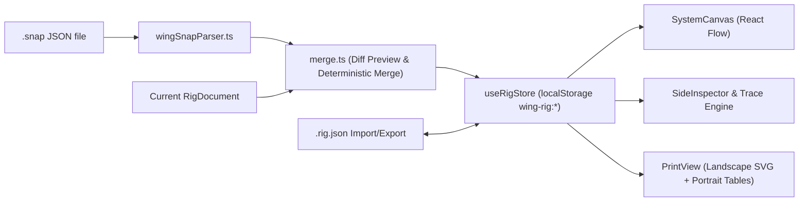

# WING Rig Visualizer — Architecture

## Data Flow

The UI is **100% decoupled** from raw Behringer WING `.snap` JSON. Only `src/parser/wingSnapParser.ts` reads `ae_data.*` fields; every component consumes the canonical `RigDocument` types defined in `src/schema/rig.ts`.

## Canonical Data Model (`src/schema/rig.ts`)

- **`RigDocument`**: Top-level portable document (`schemaVersion`, `id`, `name`, `venue`, `updatedAt`, `sourceSnapshots`, `nodes`, `trunks`, `annotations`).
- **`HardwareNode`**: Any physical device (`console`, `stagebox`, `wireless`, `iem`, `media`, `amp`, `external`) with `zone`, `model`, `position`, `portGroups`, `channels`, `mixBuses`, and `sourceOrigin` (`"snapshot" | "manual"`).
- **`PortGroup`**: Logical I/O bank on a node (`LCL`, `AUX`, `A`, `B`, `C`, `SC`, `USB`, `CRD`, `MOD`, `PLAY`, `REC`, `AES`, `ANALOG`, `DANTE`, `NETWORK`) with direction (`input | output | bidirectional`) and `ChannelPatch[]` entries.
- **`TrunkConnection`**: Aggregated cable or digital snake between two nodes (`sourceNodeId` → `targetNodeId`) with `protocol` (`aes50 | analog-xlr | analog-trs | dante | usb | network | stageconnect`), `cableLabel`, `channels` (forward direction), and `returnChannels` (reverse direction).
- **`ChannelPatch`**: Normalized per-channel fact (`slot`, `rawName`, `mode`, `gainDb`, `phantom48v`, `polarityInverted`, `muted`, `consoleChannel`, `routedTo`, `routedFrom`, `mixBusSends`, `passthroughSource`).
- **`AnnotationOverlay`**: Keyed by stable IDs (`nodes`, `trunks`, `channels`, `buses`) storing `friendlyName`, `cableTag`, `notes`, `position`, plus `orphaned` entries preserved when a `.snap` update removes a previously annotated item.

## Deterministic Merge Strategy (`src/parser/merge.ts`)

When importing a new `.snap` into an existing `RigDocument`:

1. **Target resolution:** Match the imported console by `creator_name` / target console node ID.
2. **Layer 1 replacement for snapshot-owned entities:** Update the console's port groups, channel strips, mix buses, and snapshot-derived trunks/stageboxes deterministically using stable keys (e.g., `node:<consoleId>:in:A:1`, `trunk:<consoleId>:A`).
3. **Layer 2 preservation:**
   - Keep all manual hardware nodes (`sourceOrigin: "manual"`) and manual trunks untouched.
   - Keep node canvas `(x, y)` positions from `annotations.nodes[id].position` or prior `node.position`.
   - Keep user-authored `friendlyName`, `cableTag`, and `notes` across matching IDs.
4. **Orphan detection:** If an annotation key exists for a channel, bus, node, or trunk that disappeared in the new snapshot, move a snapshot of that annotation into `annotations.orphaned` with timestamp and last-known label so nothing is silently lost.
5. **Pre-apply diff preview:** `computeSnapMergeDiff()` computes counts and item lists for added, updated, removed, and orphaned entries before mutating state.
6. **Idempotency:** Merging the exact same `.snap` twice produces identical structural output and zero spurious orphans.

## Verified Behringer WING `.snap` Schema Reference

Verified directly against `wing-rig/fixtures/snapshots/SHC-Monitor.snap` (`type: "snapshot.11"`, `creator: "WING Edit"`, `creator_vers: "3.3.2"`, `creator_model: "wing"`, `creator_name: "SHC-MONITOR"`):

| JSON Path | Structure & Behavior |
|---|---|
| `ae_data.io.in.<GRP>.<N>` | Groups: `LCL` (24 on WING Rack), `AUX` (8), `A`/`B`/`C` (48 each), `SC` (32), `USB` (48), `CRD` (64), `MOD` (64), `PLAY` (4), `AES` (2), `USR` (56), `OSC` (2). Fields: `name`, `mode` (`"M" \| "ST"`), `g` (gain dB), `vph` (+48V bool), `pol`, `mute`, `col`, `icon`, `rmt`. |
| `ae_data.io.out.<GRP>.<N>` | Groups: `LCL` (8), `AUX` (8), `A`/`B`/`C` (48 each), `SC` (32), `USB` (48), `CRD` (64), `MOD` (64), `REC` (4), `AES` (2). Fields: `{ grp, in }` (`grp: "OFF"` = unpatched). Supports direct cross-trunk pass-throughs (e.g. `out.C.1..23 <- A.1..23`, `out.C.25..48 <- LCL.*`, `out.A.16 <- C.48`). |
| Stereo output slots | `BUS` `1..32` → Bus `Math.ceil(in / 2)` (`odd=L, even=R`); `MAIN` `1..8` → Main `Math.ceil(in / 2)`; `MTX` `1..16` → Matrix `Math.ceil(in / 2)`; `MON` `1..4` → Monitor `Math.ceil(in / 2)` resolving source from `ae_data.cfg.mon.<1\|2>.src` (e.g. `"BUS.7"`). |
| `ae_data.ch.<1..40>` & `ae_data.aux.<1..8>` | `in.conn` (`{ grp, in, altgrp, altin }`), `clink` inheritance (if `ch.name === ""` and `clink` is true, inherit `io.in[grp][in].name`; non-empty `ch.name` overrides), `send.<1..16>` (`{ on, lvl, mode }`), `main.<1..4>`. |
| `ae_data.bus.<1..16>`, `main.<1..4>`, `mtx.<1..8>` | Mix bus definitions (`name`, `busmono`, `mute`, `col`). |

## Storage & Isolation

- Browser persistence uses only `wing-rig:document:v1` and `wing-rig:prefs:v1` in `localStorage`.
- Vite builds with `base: './'` so all static assets resolve cleanly under `/horton-apps-public/wing-rig/`.
